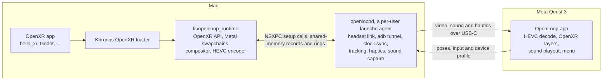

# OpenLoop

OpenLoop is an open-source OpenXR runtime that streams VR apps from your computer to a standalone
headset: today from a Mac to a Meta Quest 3 over USB-C, with Wi-Fi and more platforms planned.

Today OpenLoop runs on macOS, for apps that render with Metal, and streams to a Meta Quest 3 over
USB-C. It is early, pre-release software: it has been tested on one Mac and one Quest 3 (see
[Platforms and tested hardware](#platforms-and-tested-hardware)), and there are no published
binaries yet. It is meant to
grow into a cross-platform OpenXR framework, with hosts other than macOS and clients for other
headsets, such as a Linux client for Valve's Steam Frame and an Apple Vision Pro client (see
[Direction](#direction-beyond-the-mac-and-the-quest-3)).

## What OpenLoop is

OpenLoop is an OpenXR runtime plus the streaming system that lets it use a standalone headset as
its display. It is not an engine or an SDK: apps keep using the standard OpenXR API, and OpenLoop
is what that API runs on. It has three parts:

1. **The runtime** (`libopenloop_runtime.dylib`). OpenXR is the standard API that VR apps
   (Godot, Unity, `hello_xr`) are written against. Every platform needs a runtime that implements
   it, and the Khronos loader picks that runtime when an app starts VR. OpenLoop's runtime
   implements instances, sessions, tracking spaces, controller input, the frame loop and Metal
   swapchains.
2. **The service** (`openloopd`). A per-user background agent that owns the headset connection.
   It takes the frames the app renders, encodes them as HEVC with the Mac's hardware encoder,
   captures the app's sound, sends both to the headset over USB-C, and receives head and
   controller tracking back, with the two clocks kept in sync.
3. **The headset app** (`openloop.quest`). On the Quest it decodes the video, shows it through
   the headset's own compositor so motion stays smooth, plays the sound in sync, and sends the
   tracking back.

To the app, the headset looks as if it were plugged into the Mac. The closest relatives are ALVR,
Virtual Desktop and Meta Quest Link, which stream from Windows (and, for ALVR, Linux) PCs, and
WiVRn, an OpenXR runtime that streams from Linux. OpenLoop does this for the Mac, written from
scratch in Rust.

The parts that are not specific to the Mac or the Quest, such as the wire protocol, the streaming
core and the audio playout, are separate crates, so other hosts and other headset clients can be
built from them. That is the sense in which OpenLoop grows into a framework.

## Why OpenLoop exists

Apple ships no OpenXR runtime for macOS, and the PC VR software that headset makers provide
runs on Windows, and in some cases Linux, but not on macOS. A developer on a Mac therefore has
few ways to run an OpenXR app, such as a Godot project, in a headset straight from the Mac. The
usual choices are to build and install a headset package for every change, or to keep a Windows
PC for VR work.

OpenLoop fills that gap. To an app it is an ordinary OpenXR runtime, found by the Khronos loader
through a runtime manifest. The app renders on the Mac's GPU as it would for a headset wired to
a PC, and OpenLoop does the rest. OpenLoop has no game or app logic of its own: it is meant to be
the base that Mac VR apps, games and tools are built and tested on.

The same gap exists for other headsets on a Mac, and for some other pairings of computer and
headset. That is why OpenLoop keeps the host and the headset apart: everything specific to a
headset lives in its client app and in the device profile the client sends when it connects.

## Why "OpenLoop"

The project began as Tether, named for the USB cable. It is going to run over Wi-Fi too, and it is
open source, so it became OpenLoop.

The name is also a small oxymoron, on purpose. OpenLoop closes a loop between a person and an
experience: what you do moves the world, and what the world shows changes what you do next. But
it is still VR, not reality, and you can take the headset off at any moment, so the loop never
quite closes. It stays open, like the source.

It is not to be confused with an open-loop control system, which acts without measuring the
result. Rest assured, OpenLoop listens, and listens closely: the headset sends its head and
controller poses many times a second, the two devices' clocks are kept in sync, and every frame
the app renders is posed from that tracking, predicted to the moment it reaches your eyes.

## Status

Pre-release. Build from source. The milestones are in [`docs/ROADMAP.md`](docs/ROADMAP.md),
and the design is in [`docs/ARCHITECTURE.md`](docs/ARCHITECTURE.md).

### What works today

- **An OpenXR runtime for Metal apps.** The runtime implements the OpenXR core API that
  Khronos's `hello_xr` and stock Godot 4.7 use (instance, system, session lifecycle, reference
  spaces, actions, Metal swapchains and the frame loop) and one extension,
  `XR_KHR_metal_enable`. It has not been run through the OpenXR conformance tests and is not a
  conformant OpenXR implementation.
- **Streaming over USB-C.** Each frame is composited, filtered and encoded as HEVC at 150 Mbps
  with VideoToolbox. It reaches the headset through an `adb reverse` tunnel over its USB-C
  cable. The Quest app decodes it and submits it with the pose it was rendered for, so the
  headset's own compositor corrects for head movement since then. Apps render each eye at
  2352x2464, 1.4 times the Quest 3's recommended size, and at 90 Hz the stream carries
  1776x1856 per eye.
- **openloopd, a background service that owns the headset.** A per-user launchd agent with no
  Dock icon runs the USB tunnel, clock sync, tracking, recentring, input focus and haptics, and
  writes a report for each session. An app that crashes does not drop the headset link, and the
  next app takes the headset over.
- **The app's sound in the headset.** openloopd captures the sound of the app in front with a
  Core Audio process tap, and the headset plays it in time with the picture. The app is muted on
  the Mac only while openloopd is capturing it. This needs a one-time permission
  ([step 6](#6-hear-the-app-in-the-headset-optional)).
- **Controllers.** Head and controller tracking; the Touch controllers' buttons, triggers,
  grips, thumbsticks, touch sensors and haptics, offered to apps through the
  `oculus/touch_controller`, `meta/touch_plus_controller` and `khr/simple_controller`
  interaction profiles.
- **An in-headset menu.** Holding the left controller's menu button opens OpenLoop's menu (a
  short press still reaches the app). It recentres the view and switches passthrough and the
  headset's sharpening. While it is open the app loses input focus, so apps can pause.
- **Stock Godot.** A Godot 4.7 project with OpenXR enabled runs with no OpenLoop-specific code;
  [`examples/godot/hello`](examples/godot/hello) is the acceptance test.
- **Tests without a headset.** `cargo test`, and `scripts/e2e.sh`, which runs `hello_xr`
  against a scripted fake headset, both inside the app and through openloopd.

### Not yet

- Wi-Fi. USB-C is the only link (Wi-Fi is milestone R5).
- Frame pacing locked to the headset's display. `xrWaitFrame` paces a local timer at the
  headset's refresh rate and predicts a fixed 40 ms latency (R2 stage S4).
- Compositing and encoding inside openloopd: today they run in the app's process (stage S3).
  There are no real-time threads yet, and restarting openloopd ends running sessions (stage S5).
- A menu-bar app, an in-headset launcher, pairing, and registering OpenLoop as the system's
  OpenXR runtime (R7). Today apps are started through `scripts/run.sh`.
- Measured motion-to-photon latency, hand tracking, Vulkan apps (through MoltenVK), the
  Mac-window headset simulator and the OpenXR conformance test suite.

## Platforms and tested hardware

Today OpenLoop has one host, for macOS, and one headset client, the Quest app. Everything so far has
been tested on one setup:

| | Tested |
| --- | --- |
| Host | MacBook Pro (Mac15,10), Apple M3 Max (30-core GPU), 36 GB memory, macOS 27.0.1 |
| Headset | Meta Quest 3, connected by USB-C |
| Apps | Khronos `hello_xr` (Metal), [`examples/godot/hello`](examples/godot/hello), and [Kenbu][kenbu], a Godot 4.7 VR rhythm game developed alongside OpenLoop |
| Tools | Xcode 26.6, Rust 1.96.1, CMake 4.5.0, Ninja 1.13.2, Android NDK 29.0.14206865, Android build-tools 36.1.0 and platform `android-36`, OpenJDK 21, Godot 4.7.2 |

| Platform | State |
| --- | --- |
| macOS on Apple silicon, with apps that render with Metal | Tested on the setup above |
| Meta Quest 3, over USB-C | Tested on the setup above |
| Other Apple silicon Macs; macOS 14.4 or later | Not tested |
| Intel Macs | Not tested |
| Quest 2, Quest Pro and Quest 3S | Declared by the Quest app; not tested |
| Wi-Fi | Planned (R5); not started |
| Hosts on Linux or Windows | Planned; not started |
| A Linux client for Steam Frame; an Apple Vision Pro client | Planned; not started |

## Help wanted: testing on other hardware

Reports from any other setup are the most useful contribution right now, whether things work or
not:

- **Other Apple silicon Macs**: M1, M2, M4 and later; base, Pro, Max and Ultra chips. The size
  of the encoded stream comes from an encoder speed measured on the M3 Max, so results from
  other media engines matter most.
- **Other macOS versions**, from 14.4 on. Only macOS 27.0.1 has been tried.
- **Quest 2, Quest Pro and Quest 3S.** The Quest app declares support for them, but it has never
  run on them.
- **Other OpenXR apps and engines** that render with Metal on macOS.
- **Intel Macs** have not been tried.

[`CONTRIBUTING.md`](CONTRIBUTING.md#reporting-hardware-test-results) says what to run and what
to include in the report. Other headsets need a new client first (see
[Direction](#direction-beyond-the-mac-and-the-quest-3)).

## Requirements

On the Mac:

- A Mac with Apple silicon, on macOS 14.4 or later. OpenLoop cannot run on an older macOS, which
  lacks `os_sync_wait_on_address`. Only macOS 27.0.1 has been tested, and Intel Macs have not
  been tried (see [Platforms and tested hardware](#platforms-and-tested-hardware)).
- Xcode, the full app rather than only the Command Line Tools, with its Metal toolchain
  component. The scripts use `/Applications/Xcode.app` unless `DEVELOPER_DIR` says otherwise.
- [Homebrew](https://brew.sh) `cmake` and `ninja`.
- Rust through [rustup](https://rustup.rs): a current stable toolchain (the 2024 edition needs
  1.85 or later) and the `aarch64-linux-android` target.
- An Apple Development signing certificate for openloopd. Xcode creates one under Settings >
  Accounts > Manage Certificates.
- For the Quest app: the Android SDK with platform-tools, build-tools, an `android-NN` platform
  and the NDK, in `~/Library/Android/sdk` or at `ANDROID_HOME`; a Java runtime, which
  `apksigner` needs; and the Android debug keystore, `~/.android/debug.keystore`.
- Optional: Godot 4.7 or later as `godot` on your `PATH` for the Godot example, and
  `bindgen-cli` to regenerate the OpenXR bindings.

On the headset:

- A Meta Quest 3 in developer mode (other Quest models have not been tried). Developer mode is
  turned on in the Meta Horizon phone app and needs a Meta developer account.
- A USB-C cable that carries data.

## Build and run

The commands below run from the root of a clone of this repository.

### 1. Install the tools

```sh
xcodebuild -downloadComponent MetalToolchain
brew install cmake ninja
rustup target add aarch64-linux-android
```

Install the Android SDK packages with Android Studio's SDK Manager or with `sdkmanager`, for
example (the versions tested):

```sh
sdkmanager "platform-tools" "build-tools;36.1.0" "platforms;android-36" "ndk;29.0.14206865"
```

Android Studio creates the debug keystore the first time it builds an app. Without Android
Studio, create it once:

```sh
keytool -genkeypair -keystore ~/.android/debug.keystore -storepass android -keypass android \
  -alias androiddebugkey -dname "CN=Android Debug,O=Android,C=US" \
  -keyalg RSA -keysize 2048 -validity 10000
```

### 2. Build

```sh
git submodule update --init   # Khronos OpenXR-SDK-Source, pinned
./scripts/openxr-sdk.sh       # Khronos loader and hello_xr, into build/openxr-sdk
cargo build                   # the runtime and openloopd, into target/debug
```

### 3. Sign and start openloopd

openloopd must be signed with an Apple Development certificate, and the runtime talks only to a
openloopd that is signed as `dev.openloop.openloopd` by the team it was built for. The scripts find
both for you (`scripts/signing.sh`): with one Apple Development certificate in your keychain
there is nothing to set. With several, choose one and keep the choice in
`~/Library/Application Support/OpenLoop/signing.env`, so `scripts/run.sh` can sign openloopd again
whenever it changes:

```sh
security find-identity -v -p codesigning   # lists "Apple Development: <name> (<ID>)"
mkdir -p ~/Library/Application\ Support/OpenLoop
echo 'OPENLOOP_SIGN_IDENTITY="Apple Development: <name> (<ID>)"' \
  > ~/Library/Application\ Support/OpenLoop/signing.env
```

The team is read from the certificate (its `OU`) and built into the runtime as `OPENLOOP_TEAM_ID`;
`OPENLOOP_SIGN_IDENTITY` and `OPENLOOP_TEAM_ID` in the environment override both. A plain `cargo`
build without `OPENLOOP_TEAM_ID` warns and builds a runtime that checks openloopd's identifier alone.

Then install and start openloopd:

```sh
./scripts/openloopd.sh install
```

This builds openloopd, signs a copy into `~/Library/Application Support/OpenLoop/`, installs the
launch agent `~/Library/LaunchAgents/dev.openloop.openloopd.plist` and starts it. It logs to
`~/Library/Logs/OpenLoop/openloopd.log`, and session reports go to `~/Library/Logs/OpenLoop/sessions/`.
`scripts/run.sh` runs the same steps when needed, so this step is optional.

### 4. Build and install the Quest app

Connect the headset by USB-C, put it on, and allow USB debugging for this Mac when it asks.
`adb devices` (`adb` is in the SDK's `platform-tools`) should then list the headset as
`device`. Then:

```sh
./scripts/quest-apk.sh --install
```

The first run also builds the Khronos loader for Android (`scripts/quest-loader.sh`, into
`build/quest-loader`). The app is packaged without Gradle as `build/openloop-quest.apk` and signed
with your debug key.

If your Android SDK is not in `~/Library/Android/sdk`, set `ANDROID_HOME`, and also
`ANDROID_NDK_HOME`, because `scripts/quest-loader.sh` looks for the NDK only there or in the
default location. Keep `ANDROID_HOME` set whenever you run `scripts/openloopd.sh` or
`scripts/run.sh`, since openloopd finds `adb` through it and its launchd plist is rebuilt from the
environment each time.

### 5. Run an OpenXR app

Open OpenLoop on the headset. It is in the app library under Unknown Sources. Keep the headset
connected; openloopd keeps the USB tunnel up while it is attached. Then, on the Mac:

```sh
./scripts/run.sh build/openxr-sdk/src/tests/hello_xr/hello_xr -g Metal
```

`scripts/run.sh` builds the runtime and makes sure this checkout's openloopd is installed and
running (`scripts/openloopd.sh ensure`, which leaves an up-to-date openloopd and its headset link
alone). It then writes a runtime manifest to `build/openloop_runtime.json` and starts the app with
`XR_RUNTIME_JSON` pointing at it, so OpenLoop is not installed system-wide. Put `--release` first
to build and run release builds.

A Godot project runs the same way:

```sh
godot --headless --import --path examples/godot/hello   # once
./scripts/run.sh godot --path examples/godot/hello
```

[`examples/godot/hello`](examples/godot/hello) is stock Godot with OpenXR enabled and nothing
OpenLoop-specific. A Godot 4.7 project of your own works if it enables OpenXR
(`xr/openxr/enabled`) and XR shaders (`xr/shaders/enabled`) and uses the Metal driver on macOS
(`rendering/rendering_device/driver.macos`), as the example does.

Apps are asked to render each eye at 1.4 times the headset's size, which OpenLoop filters down to
what it encodes; `OPENLOOP_RENDER_SCALE=1.0 ./scripts/run.sh …` renders at the headset's own size
instead. See [Video quality](docs/ARCHITECTURE.md#video-quality).

### 6. Hear the app in the headset (optional)

openloopd plays the sound of the app in front in the headset. macOS asks once for the System Audio
Recording permission, and the prompt has to be answered at the Mac:

```sh
./scripts/openloopd.sh audio-permission   # click Allow when macOS asks
./scripts/openloopd.sh audio-check        # captures a 3 s test tone through the installed openloopd
```

Until the permission is granted, openloopd does not touch Core Audio and the sound stays on the
Mac. The grant belongs to the installed binary, so signing openloopd with another certificate can
mean granting it again. The script refuses to run while a system alert is on screen or after a
capture was blocked, because capture calls made while a permission prompt is pending once left
the Mac's audio stuck for hours (see [Troubleshooting](#troubleshooting)). To keep the sound on
the Mac, keep `OPENLOOP_AUDIO=off` in your environment, for example in your shell profile. Both
`scripts/openloopd.sh install` and the `ensure` that `scripts/run.sh` runs rebuild openloopd's
launchd plist from the environment, so a setting given only to `install` is dropped, and
openloopd restarted without it, the next time `scripts/run.sh` runs.

## Settings

| Variable | Read by | Effect |
| --- | --- | --- |
| `OPENLOOP_SIGN_IDENTITY` | `scripts/openloopd.sh` (also through `run.sh` and `e2e.sh`) | The certificate that openloopd is signed with |
| `OPENLOOP_RENDER_SCALE` | the app's process | Eye render size relative to the headset's, from 0.5 to 2.0; default 1.4 |
| `OPENLOOP_AUDIO` | `scripts/openloopd.sh install` and `ensure` (so also `scripts/run.sh`); keep it set in your environment | `tap` (default), `synthetic` (a 440 Hz tone for every app, for tests) or `off` |
| `OPENLOOP_USB_PORT` | `scripts/openloopd.sh install` and `ensure` (keep it set, as for `OPENLOOP_AUDIO`), or the app with `OPENLOOP_INPROCESS=1` | Moves the headset listener off port 47800 (`0`: any free port) and leaves adb alone; for tests |
| `OPENLOOP_INPROCESS=1` | `scripts/run.sh` | Runs the headset link inside the app, as before openloopd. Stop openloopd first (`scripts/openloopd.sh stop`). Kept for comparisons until stage S5 |
| `OPENLOOP_SERVICE` | the app's process | Connects the runtime to another openloopd Mach service; used by tests |
| `ANDROID_HOME`, `ANDROID_NDK_HOME` | Quest scripts, openloopd | Android SDK and NDK; default `~/Library/Android/sdk` and its newest NDK |
| `DEVELOPER_DIR` | build scripts | The Xcode to build with; default `/Applications/Xcode.app/Contents/Developer` |

## Managing openloopd

Every `scripts/openloopd.sh` command is safe to repeat.

| Command | Does |
| --- | --- |
| `install [--release]` | Build, sign, install and (re)start openloopd |
| `ensure [--release]` | The same, but leave an up-to-date running openloopd and its headset link alone; `scripts/run.sh` uses it |
| `restart` | Relaunch it |
| `stop` | Unload it until the next `install` or `ensure` |
| `status` | Show launchd's view of it |
| `log` | Follow its log |
| `uninstall` | Unload it and remove what `install` put in place; logs stay in `~/Library/Logs/OpenLoop` |
| `sign <from> <to>` | Copy a openloopd binary and sign it as openloopd |
| `audio-permission` | Once, at the Mac: the System Audio Recording prompt |
| `audio-check` | Capture a 3 s test tone through the installed openloopd |

## Tests

```sh
cargo test                     # never touches a headset
./scripts/e2e.sh               # hello_xr against a fake headset, in-process and through openloopd
./scripts/e2e.sh --inprocess   # in-process only; needs no signing certificate
cargo test -p openloop-stream --release --test encode_latency -- --ignored composed_frames
```

`scripts/e2e.sh` fails unless the video arrives at the headset's refresh rate, every stream
starts with a keyframe and frame indices have no gaps. Through openloopd, it also kills one app
mid-stream, checks that a second app takes over the same headset link, and checks the app's
sound. It never touches adb, port 47800, the installed openloopd, Core Audio or a running app; its
openloopd runs under a throwaway launchd label, signed with `OPENLOOP_SIGN_IDENTITY`. The last
command checks the encode-latency gate on this Mac's media engine. See
[Testing](docs/ARCHITECTURE.md#testing) and the
[quality gates](docs/ROADMAP.md#quality-gates).

## Troubleshooting

- **The app fails at `xrCreateInstance` with `XR_ERROR_RUNTIME_UNAVAILABLE`.** The runtime
  could not reach a openloopd it trusts. Check `./scripts/openloopd.sh status`,
  `./scripts/openloopd.sh log` and the signing setup in [step 3](#3-sign-and-start-openloopd).
- **The headset does not connect.** `adb devices` should list it as `device`; `unauthorized`
  means the headset is waiting for you to allow USB debugging. openloopd recreates the
  `adb reverse` tunnel every few seconds, and its log says what it sees.
- **Apps on the Mac hang when they start playing sound** after a permission prompt was left
  unanswered. Answer any prompt on screen, then restart the Mac's audio services (or the Mac):
  `sudo killall coreaudiod`, then `sudo launchctl kickstart system/com.apple.audiomxd`. Run
  `./scripts/openloopd.sh audio-permission --prompt-answered` afterwards.

## How it works



- **The app's process.** The Khronos loader finds `libopenloop_runtime.dylib` through the runtime
  manifest. The runtime implements the OpenXR API in the app's process. Today it also composites
  each frame and encodes it with VideoToolbox; stage S3 of milestone R2 moves both into openloopd.
- **openloopd** owns the headset, so an app never does. The runtime reaches it over NSXPC for
  setup calls and through shared memory for everything that happens every frame. openloopd runs
  the USB link (one TCP stream through `adb reverse`), maps the Mac's clock to the headset's,
  publishes tracking and captures the app's sound.
- **The Quest app** is pure Rust. It decodes each frame with MediaCodec and submits it with the
  pose it was rendered for; the headset's compositor does lens distortion and reprojection.
  AAudio plays the sound at the time it is due.
- **One clock.** Every time the app sees is in the Mac's monotonic clock. A frame's predicted
  display time and its sound are both set the same pipeline latency ahead, so they line up.

[`docs/ARCHITECTURE.md`](docs/ARCHITECTURE.md) is the full design: processes, the runtime ↔
openloopd contract, time, audio, transports, headsets and video quality.

## Repository layout

| Path | What |
| --- | --- |
| `packages/rust/runtime` | `libopenloop_runtime`, the OpenXR runtime the loader loads |
| `packages/rust/ipc` | The runtime ↔ openloopd contract: NSXPC and shared memory |
| `packages/rust/protocol` | The wire protocol, shared with the Quest app |
| `packages/rust/stream` | Link, clock sync, poses, compositor, encoder |
| `packages/rust/audiotap` | Core Audio process-tap capture for openloopd |
| `packages/rust/playout` | The headset's audio playout, testable on the Mac |
| `packages/rust/openxr-abi`, `openxr-gen` | OpenXR C types and the runtime's dispatch table, generated from the Khronos headers and registry |
| `packages/rust/fake-headset`, `e2e` | The scripted headset and the end-to-end check behind `scripts/e2e.sh` |
| `apps/openloopd` | openloopd, the per-user agent that owns the headset |
| `apps/quest` | The Quest app |
| `examples/godot` | Stock Godot projects, the developer-facing acceptance test |
| `scripts` | SDK build, bindings, run, openloopd, Quest packaging and the end-to-end check |
| `third_party/OpenXR-SDK-Source` | The Khronos OpenXR SDK, a pinned git submodule |
| `docs` | Architecture and roadmap |

## Roadmap

From [`docs/ROADMAP.md`](docs/ROADMAP.md):

| | Milestone | Status |
| --- | --- | --- |
| R0 | Workspace; Khronos loader and `hello_xr` built; the runtime loads | Done |
| R1 | Simulated headset: full API in-process, both eyes in a Mac window, keyboard and mouse input; the OpenXR conformance tests | API done in-process; the Mac-window simulator and the conformance tests are not built |
| R2 | openloopd out of process: IPC, shared GPU textures, the app's sound in the headset | Stage S2 done; S3 next |
| R3 | Pure-Rust Quest app over USB | Done, except that round-trip latency is not reported |
| R4 | Streaming: VideoToolbox to MediaCodec, pose-tagged frames, pacing, recentring; Godot in the headset | Godot streams over USB-C; pacing waits for R2 stage S4 |
| R5 | Wi-Fi: discovery, error correction and retransmission, adaptive bitrate | Not started |
| R6 | Tuning to the quality gates; full controller input and haptics | Not started |
| R7 | Menu-bar app, launch agent packaging, in-headset launcher, pairing, system runtime registration | Not started |

openloopd's remaining stages (R2):

| Stage | Delivers |
| --- | --- |
| S3 | The GPU path moves into openloopd: shared textures and events, composition and encoding in openloopd; the runtime drops VideoToolbox |
| S4 | `xrWaitFrame` locked to the headset's vsync, shifted by the measured latency |
| S5 | Hardening: app crashes and openloopd restarts, several apps, real-time threads; the in-process path removed |
| S6 | Packaging with R7: the menu-bar app registers the agent; a per-user active runtime |

## Direction: beyond the Mac and the Quest 3

OpenLoop is meant to become a cross-platform OpenXR framework: runtimes for several host systems
and client apps for several headsets, speaking one protocol. These are plans. None of them has
started, and none has a date.

- **More headsets.** The host never assumes a headset. A client sends a device profile when it
  connects (displays, codecs, interaction profiles and features), and the host configures
  itself from it ([Headsets](docs/ARCHITECTURE.md#headsets)). The candidates are:
  - other Android OpenXR headsets, starting with the Quest models the app already declares,
    which need a profile and any quirks;
  - a Linux client for Valve's Steam Frame;
  - an Apple Vision Pro client.
- **More hosts.** The macOS-specific parts are the Metal graphics binding, the NSXPC and shared
  memory between the runtime and openloopd, the Metal compositor, VideoToolbox, Core Audio capture
  and launchd. A host for another system, such as Linux or Windows, would replace those with
  that platform's graphics bindings (for example Vulkan), IPC, encoder, audio capture and service
  manager. It would share the wire protocol and the clients.
- **Wi-Fi** for every client (R5).

If you would like to work on a host or a client, please open an issue first so the design can
be agreed before the code.

## Contributing

OpenLoop is built by a human maintainer who directs AI coding agents and reviews their work.
[`AI.md`](AI.md) is the single source of truth that every agent follows: `CLAUDE.md`,
`AGENTS.md`, `GEMINI.md` and the other agent rule files are symbolic links to it. Its rules apply
to human contributors too. AI is never attributed in commits: the human author owns every commit
and answers for every line in it.

Contributions are welcome, written by hand or with AI tools. Right now the most useful help is
testing on hardware we do not have (see
[Help wanted](#help-wanted-testing-on-other-hardware)). [`CONTRIBUTING.md`](CONTRIBUTING.md) has
the rules, the checks to run, the commit policy and what to put in a hardware report.

## Licence

OpenLoop is licensed under either of

- the Apache License, Version 2.0 ([`LICENSE-APACHE`](LICENSE-APACHE)), or
- the MIT licence ([`LICENSE-MIT`](LICENSE-MIT)),

at your option. Copyright (c) 2026 The OpenLoop contributors.

Unless you explicitly state otherwise, any contribution intentionally submitted for inclusion in
the work by you, as defined in the Apache-2.0 license, shall be dual licensed as above, without
any additional terms or conditions.

Third-party material and its licences are listed in
[`THIRD_PARTY_NOTICES.md`](THIRD_PARTY_NOTICES.md).

## Acknowledgements

- The Khronos Group's [OpenXR SDK](https://github.com/KhronosGroup/OpenXR-SDK-Source): the
  loader, headers, registry and `hello_xr`. OpenLoop's OpenXR bindings and dispatch table are
  generated from its headers and registry.
- The Rust crates OpenLoop builds on, among them the `objc2` family for Apple's frameworks,
  `openxr`, `android-activity` and `ndk` for the Quest app, and `glow`, `fontdue` and `glam`. The
  full list is in [`THIRD_PARTY_NOTICES.md`](THIRD_PARTY_NOTICES.md).
- [Godot Engine](https://godotengine.org), whose stock OpenXR support is OpenLoop's acceptance
  test.
- [OXRSys](https://github.com/demonixis/oxrsys), an earlier open-source OpenXR runtime for macOS
  that streams to Quest headsets. It was studied as prior art while OpenLoop was designed. OpenLoop
  contains none of its code.

## Trademarks

OpenLoop is an independent project. It is not affiliated with, endorsed by or sponsored by The
Khronos Group, Meta, Apple, Valve, Google or the Godot Foundation. OpenXR and the OpenXR logo are
trademarks owned by The Khronos Group Inc. Meta Quest, Apple, Mac, macOS, Metal, Apple Vision Pro,
Steam Frame, Android, Godot, Unity and Virtual Desktop are trademarks of their respective owners.
These names are used only to describe what OpenLoop works with, is planned to work with or is
compared with. The full list is in
[`THIRD_PARTY_NOTICES.md`](THIRD_PARTY_NOTICES.md#5-trademarks).

<!-- Before publishing: replace OWNER with the account that hosts Kenbu's repository. -->
[kenbu]: https://github.com/OWNER/kenbu
